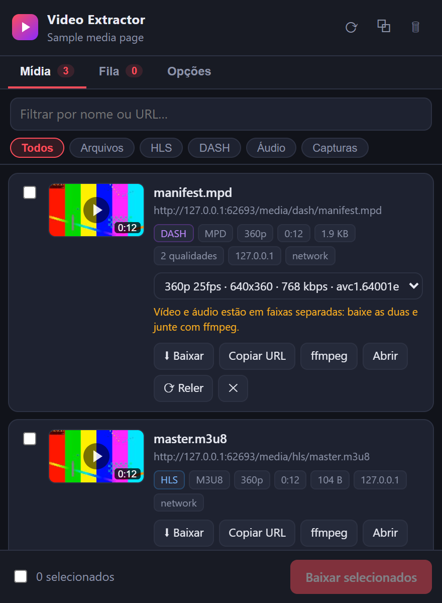
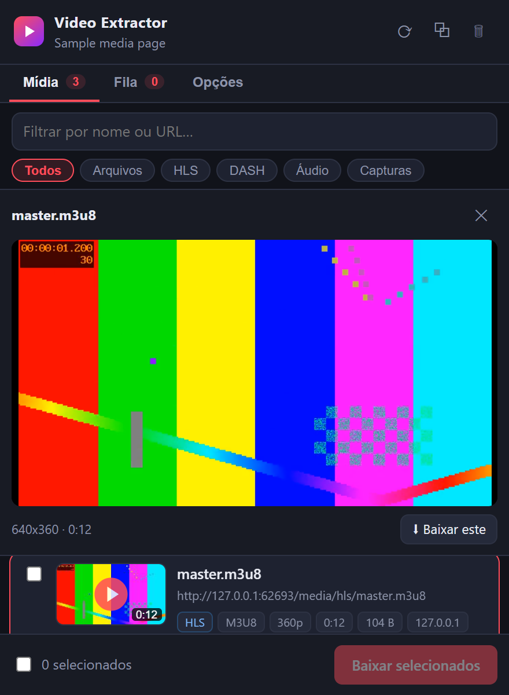
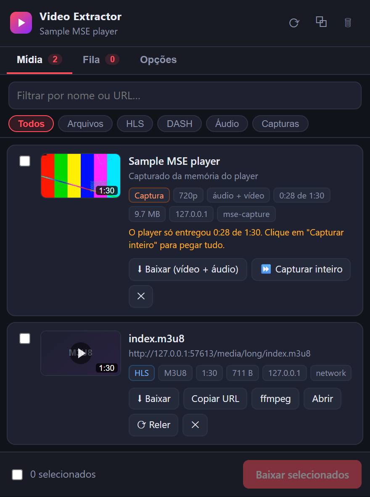
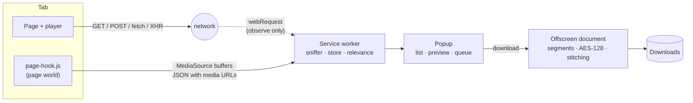

<div align="center">


# Video Extractor

**Every video a page actually loads, in one list. Pick what you want to keep.**

No list of supported sites. It watches what the page downloads —
files, HLS, DASH, and streams that only ever exist inside the player.

[](https://github.com/XuanDeveloper/video-extractor/actions/workflows/ci.yml)
[](LICENSE)
[](extension/manifest.json)
[](#install)
[](#development)

<br />



</div>

<br />

## Why this exists

Most video downloaders work from a list of sites someone taught them about.
When the site changes, or isn't on the list, you get nothing.

But every player, on every site, has to fetch the video somehow. So this
extension doesn't know about sites at all. It reads the traffic of the tab —
GET, POST, `fetch`, `XHR` — and the buffers the player pushes into
`MediaSource`, and reports what's there.

The hard part turned out not to be *finding* video. A single page loads
hundreds of media requests: segments, ad creatives, UI sounds, the same file
under five signed URLs. The work went into **showing only what you can actually
download and watch** — usually one or two items.

## What it does

|  | |
|---|---|
| **Finds files and streams** | Progressive files (`.mp4`, `.webm`, `.mkv`, …), audio, **HLS** and **DASH** — by URL, `Content-Type`, and URLs hidden in JSON responses or POST bodies. |
| **Captures what has no URL** | Players that build the video in memory with their own protocol get one item per player, rebuilt from the `SourceBuffer` data — **video + audio in a single WebM/MKV**, remuxed without re-encoding. |
| **"Capture all"** | A player only buffers a little ahead. This plays it muted at up to 16×, backing off if the network can't keep up, then puts the player back exactly as it was. |
| **Picks the quality** | Lists every HLS variant and DASH representation, separate audio tracks included. |
| **Shows before you save** | A thumbnail from a real frame, and a built-in player for files, HLS (with quality switch) and DASH. |
| **Keeps the list short** | Hides segments, variant playlists of a listed master, ads, UI sounds, tiny files, duplicate signed URLs and expired manifests. One switch brings them all back. |
| **Downloads properly** | Parallel segments with retries, byte ranges, AES-128 HLS decryption, the page's `Referer` replayed so CDNs don't refuse. |

<div align="center">


</div>

## Install

Grab the zip from [Releases](https://github.com/XuanDeveloper/video-extractor/releases), unzip it, then:

1. Open `chrome://extensions` (`brave://extensions`, `edge://extensions`).
2. Turn on **Developer mode**.
3. **Load unpacked** → pick the unzipped folder (the one with `manifest.json`).
4. Pin the icon. Open a page, **press play**, click the icon.

Or from source: clone, and load the `extension/` folder.

> Pressing play matters. Most players don't request the manifest or a single
> byte of video until playback starts. Empty list? Play, then hit ⟳.

After updating, click ↻ on the extension card and **reload the tab** — content
scripts only attach to pages loaded after that.

## How it finds videos



Three sources, because each one misses something the others catch:

- **`webRequest`** sees every request the tab makes, including POST bodies and
  response types. It never blocks or rewrites anything.
- **A hook in the page's own world** wraps `fetch`/`XHR` (media URLs buried in
  API responses) and `MediaSource`/`SourceBuffer` — for players whose video only
  ever exists as bytes appended to a buffer.
- **The DOM**: `<video>`, `<source>`, JSON-LD, `data-*` attributes.

### Rebuilding a stream from the player's buffers

When a player streams over its own protocol, there's no file to point at. But
the decoded result still has to go through `SourceBuffer.appendBuffer()`, and
that data is ordinary fragmented MP4 or WebM.

So the hook keeps those appends — grouped per `MediaSource`, split on `abort()`
and `timestampOffset` changes, keyed by init segment so quality switches don't
mix — and [`mse-mux.js`](extension/src/content/mse-mux.js) turns them into one
Matroska file: demux `moof`/`trun` and WebM clusters, rebuild GOPs, drop the
overlaps a seek leaves behind, and write video and audio as two tracks with
proper Cues. No re-encoding, no ffmpeg, no WebAssembly.

## Honest limitations

- **DRM is not bypassed, and won't be.** Widevine, PlayReady, FairPlay,
  `SAMPLE-AES` and EME sessions are detected, labeled, and the download is
  blocked. The only decryption is HLS AES-128 with a key the manifest hands to
  any player — the same thing `ffmpeg` does by default.
- **HLS/DASH downloads aren't remuxed.** MPEG-TS HLS comes out as `.ts`, and
  DASH's separate video and audio come out as two files; join them with
  `ffmpeg -i video.mp4 -i audio.m4a -c copy out.mp4`. (Player captures *are*
  joined.)
- **Capture only sees what was loaded after the page opened** with the extension
  active. Default memory cap: 1 GB, adjustable.
- **Live streams**: you get what's in the playlist at that moment.
- **Everything is assembled in memory** before it reaches Downloads. Very long
  videos use a lot of RAM.
- **"Capture all" depends on the site letting the player buffer.** Some sites
  throttle or reset playback for automated or accelerated sessions.
- **The UI is in Portuguese.** It's what I use. PRs adding `_locales` are welcome.
- **Not on the Chrome Web Store.** Install it unpacked.

## Use it responsibly

Download what's yours, what's in the public domain or licensed for it, or what
you have permission to keep. Many sites' terms of service forbid downloading
outside their own offline features — that's between you and them. This
extension does not remove technical protection measures.

## Privacy

Nothing leaves your machine: no server, no analytics, no telemetry. `Cookie` and
`Authorization` headers are never stored. Every permission is justified in
**[PRIVACY.md](PRIVACY.md)**.

## Architecture

Plain ES modules, loaded as-is. No bundler, no framework.

```
extension/
├── manifest.json
└── src/
    ├── background/
    │   ├── service-worker.js   Routing, per-tab state, badge, context menu, DNR rules
    │   ├── sniffer.js          webRequest listeners: URLs, MIME, POST bodies
    │   ├── relevance.js        Decides what's worth showing — and why the rest isn't
    │   ├── store.js            Per-tab media registry, persisted in storage.session
    │   ├── jobs.js             Download queue and progress
    │   └── probe.js            Reads HLS/DASH manifests to list qualities
    ├── content/
    │   ├── page-hook.js        PAGE WORLD: fetch/XHR/MediaSource hooks, capture
    │   ├── mse-mux.js          PAGE WORLD: fMP4 + WebM → Matroska remuxer
    │   └── content.js          Isolated world: DOM scan, bridge to the worker
    ├── offscreen/
    │   ├── downloader.js       Segments, AES-128, byte ranges, final blob
    │   └── thumbs.js           Thumbnail from a real frame (skips black ones)
    ├── lib/                    classify · m3u8 · mpd parsers · player · utils
    ├── popup/                  List, preview player, quality picker, queue, settings
    └── vendor/                 hls.js 1.5.17, dash.js 4.7.4 (MV3 forbids remote code)
```

<details>
<summary><b>Three MV3 traps worth knowing about</b></summary>
<br />

**1. The offscreen document can't download.** It only gets `chrome.runtime`. So
it builds the blob, hands the `blob:` URL to the service worker (same extension
origin), and the worker calls `chrome.downloads`. Then the offscreen document
revokes the URL.

**2. `fetch()` can't set `Referer`.** Plenty of CDNs refuse a request without the
page's `Referer`/`Origin`. The fix is temporary `declarativeNetRequest` session
rules installed per job and removed when it ends.

**3. A thumbnail grabbed right after `seeked` is black.** With MSE, `seeked` fires
before the frame is decoded. The thumbnailer plays muted until `currentTime`
actually advances, grabs the frame, and retries further in if it's mostly black.

</details>

## Development

You need Node 20+ and `ffmpeg` on your `PATH`.

```bash
npm install
npm run check       # ESLint + unit tests + manifest sanity check
npm run test:e2e    # real browser, extension loaded, local media server (~1 min)
npm run package     # dist/video-extractor-<version>.zip + SHA256SUMS
```

The tests make their own media with ffmpeg — color bars and a sine tone, nothing
downloaded or copyrighted. The remuxer tests cover AV1-in-fMP4 + Opus-in-WebM,
H.264 with B-frames + AAC, VP9, a mid-stream quality switch, overlapping parts
after a seek and a capture truncated mid-box; every output is fully decoded by
ffmpeg and must produce zero errors.

The end-to-end tests run Chrome for Testing by default. To run them on your own
Brave or Edge:

```bash
BROWSER="C:/Program Files/BraveSoftware/Brave-Browser/Application/brave.exe" \
PROFILE=.profile-brave npm run test:e2e
```

`SHOTS=docs npm run test:e2e` refreshes the screenshots in this README.

See [CONTRIBUTING.md](CONTRIBUTING.md) for the ground rules.

## License

MIT. This is a personal project published as-is. Use it, fork it, learn from it.
There's no promise of support or of accepting feature requests — but bug reports
with a page that reproduces the problem are genuinely useful.

Bundled third-party code: [hls.js](https://github.com/video-dev/hls.js) (Apache-2.0)
and [dash.js](https://github.com/Dash-Industry-Forum/dash.js) (BSD-3-Clause) —
see [`extension/src/vendor/LICENSES.md`](extension/src/vendor/LICENSES.md).

<div align="center">
<br />
<sub>Plain JavaScript, Manifest V3, zero runtime dependencies beyond two players · <a href="docs/README.pt-BR.md">Leia em português</a></sub>
</div>
