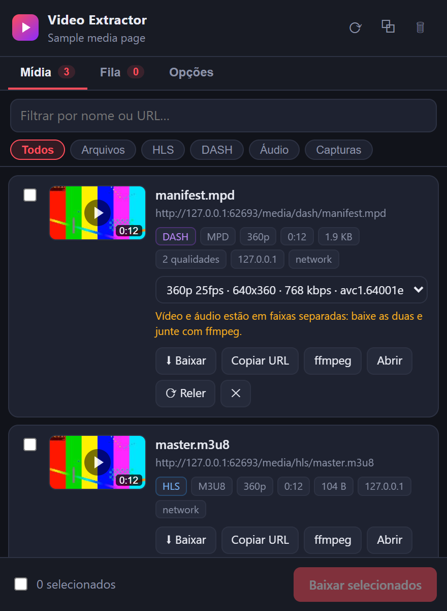
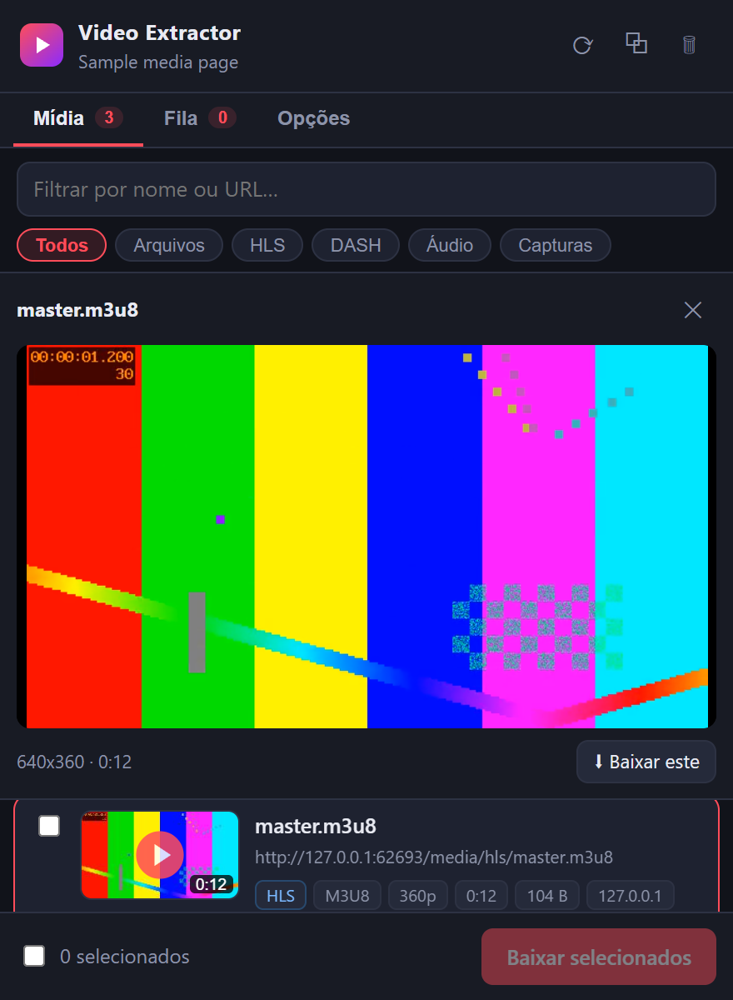
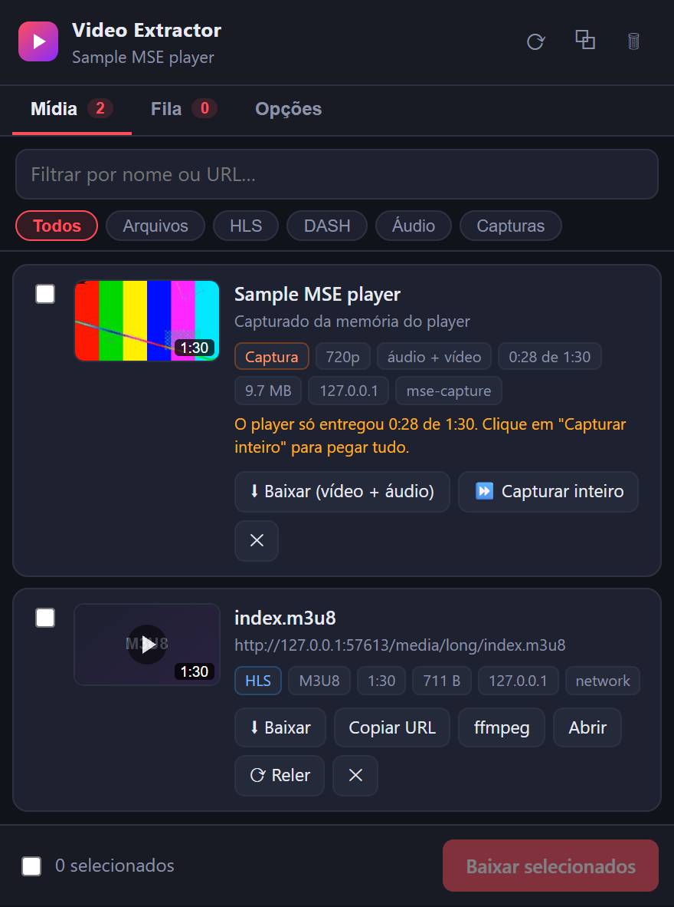

<div align="center">


# Video Extractor

**Todo vídeo que a página realmente carrega, numa lista só. Você escolhe o que guardar.**

Sem lista de sites suportados. Ela observa o que a página baixa —
arquivos, HLS, DASH e streams que só existem dentro do player.



</div>

<br />

## Por que isso existe

A maioria dos baixadores de vídeo trabalha com uma lista de sites que alguém
ensinou a eles. Quando o site muda, ou não está na lista, não sai nada.

Mas todo player, em todo site, precisa buscar o vídeo de algum jeito. Então esta
extensão não sabe nada sobre sites. Ela lê o tráfego da aba — GET, POST,
`fetch`, `XHR` — e os buffers que o player entrega ao `MediaSource`, e mostra o
que tem ali.

A parte difícil não foi *achar* vídeo. Uma página carrega centenas de
requisições de mídia: segmentos, anúncios, sons de interface, o mesmo arquivo
em cinco URLs assinadas. O trabalho foi **mostrar só o que dá para baixar e
assistir** — normalmente um ou dois itens.

## O que ela faz

|  | |
|---|---|
| **Acha arquivos e streams** | Arquivos progressivos (`.mp4`, `.webm`, `.mkv`, …), áudio, **HLS** e **DASH** — pela URL, pelo `Content-Type` e por URLs escondidas em respostas JSON ou no corpo de POSTs. |
| **Captura o que não tem URL** | Players que montam o vídeo em memória com protocolo próprio viram um item por player, reconstruído a partir dos dados do `SourceBuffer` — **vídeo + áudio num único WebM/MKV**, sem recodificar. |
| **"Capturar inteiro"** | O player só carrega um pouco à frente. Isso toca o vídeo sem som a até 16×, desacelerando se a rede não acompanhar, e devolve o player exatamente como estava. |
| **Escolhe a qualidade** | Lista todas as variantes HLS e representações DASH, incluindo faixas de áudio separadas. |
| **Mostra antes de salvar** | Miniatura de um quadro real e um player embutido para arquivo, HLS (com troca de qualidade) e DASH. |
| **Mantém a lista curta** | Esconde segmentos, sub-playlists de um master listado, anúncios, sons de interface, arquivos minúsculos, URLs assinadas duplicadas e manifests expirados. Uma opção traz tudo de volta. |
| **Baixa direito** | Segmentos em paralelo com novas tentativas, byte ranges, descriptografia AES-128 de HLS e o `Referer` da página reenviado para a CDN não recusar. |

<div align="center">


</div>

## Instalação

Baixe o zip em [Releases](https://github.com/XuanDeveloper/video-extractor/releases), descompacte e:

1. Abra `chrome://extensions` (`brave://extensions`, `edge://extensions`).
2. Ligue o **Modo do desenvolvedor**.
3. **Carregar sem compactação** → escolha a pasta descompactada (a que tem o `manifest.json`).
4. Fixe o ícone. Abra uma página, **dê play** e clique no ícone.

Ou a partir do código: clone e carregue a pasta `extension/`.

> Dar play importa. A maioria dos players não pede o manifest nem um byte de
> vídeo antes de começar a tocar. Lista vazia? Dê play e clique em ⟳.

Depois de atualizar, clique em ↻ no card da extensão e **recarregue a aba** — os
scripts só entram em páginas abertas depois disso.

## Como usar

- **Mídia** — o que foi encontrado nesta aba. Filtre por tipo, busque por nome
  ou URL, escolha a qualidade e marque os itens.
- **Clique na miniatura** para assistir antes de baixar.
- **Baixar selecionados** — enfileira tudo de uma vez.
- **Fila** — progresso por segmento, bytes recebidos e cancelamento.
- **Opções** — paralelismo, tentativas, pasta de destino, limite de captura em
  memória e **Mostrar tudo**.
- **⧉** abre a mesma interface numa aba inteira, útil para downloads longos.
- Botão direito: *"Procurar vídeos nesta página"* e, sobre um vídeo, *"Extrair este vídeo…"*.

**Em sites que montam o vídeo no player** (o card diz "Capturado da memória do player"):
dê play, clique em **⏩ Capturar inteiro**, espere o selo "CAPTURANDO" sumir com a
aba aberta e clique em **⬇ Baixar (vídeo + áudio)**.

## Limites, ditos com clareza

- **DRM não é contornado, e não vai ser.** Widevine, PlayReady, FairPlay,
  `SAMPLE-AES` e sessões EME são detectados, sinalizados, e o download fica
  bloqueado. A única descriptografia é a AES-128 de HLS, cuja chave o próprio
  manifest entrega a qualquer player — o mesmo que o `ffmpeg` faz por padrão.
- **Downloads HLS/DASH não são remuxados.** HLS em MPEG-TS sai como `.ts`, e o
  DASH, com vídeo e áudio separados, sai em dois arquivos; junte com
  `ffmpeg -i video.mp4 -i audio.m4a -c copy saida.mp4`. (A captura do player já
  sai junta.)
- **A captura só vê o que carregou depois que a página abriu** com a extensão
  ativa. Limite padrão de memória: 1 GB, ajustável.
- **Ao vivo**: vem o que está na playlist naquele momento.
- **Tudo é montado em memória** antes de ir para Downloads. Vídeos muito longos
  usam bastante RAM.
- **"Capturar inteiro" depende de o site deixar o player carregar.** Alguns sites
  limitam ou reiniciam a reprodução em sessões automatizadas ou aceleradas.
- **Não está na Chrome Web Store.** Instale sem compactação.

## Uso responsável

Baixe o que é seu, de domínio público, com licença que permita, ou com
autorização. Muitos sites proíbem nos termos de uso baixar fora dos recursos
offline deles — isso é entre você e o site. A extensão não remove medidas
técnicas de proteção.

## Privacidade

Nada sai do seu computador: sem servidor, sem analytics, sem telemetria.
Cabeçalhos `Cookie` e `Authorization` nunca são guardados. Cada permissão está
justificada em **[PRIVACY.md](../PRIVACY.md)** (em inglês).

## Desenvolvimento

Precisa de Node 20+ e `ffmpeg` no `PATH`.

```bash
npm install
npm run check       # ESLint + testes unitários + checagem do manifest
npm run test:e2e    # navegador real com a extensão, servidor de mídia local (~1 min)
npm run package     # dist/video-extractor-<versão>.zip + SHA256SUMS
```

Os testes geram a própria mídia com ffmpeg (barras de cor e um tom senoidal),
nada baixado. Para rodar os testes de navegador no seu Brave:

```bash
BROWSER="C:/Program Files/BraveSoftware/Brave-Browser/Application/brave.exe" \
PROFILE=.profile-brave npm run test:e2e
```

Arquitetura e detalhes técnicos estão no [README em inglês](../README.md#architecture).

## Licença

MIT. Projeto pessoal publicado como está. Use, faça fork, aprenda com ele. Não há
promessa de suporte nem de aceitar pedidos de funcionalidade — mas relatos de
bug com uma página que reproduz o problema são muito úteis.
